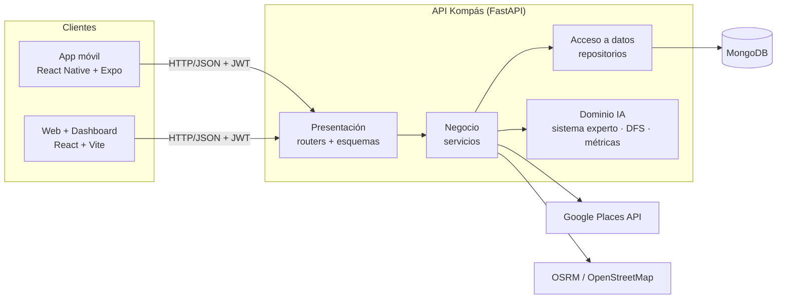

# Kompás — Arquitectura de software (v0.5)

> Parte de `PLAN_REFACTOR.md`. La reorganización se hace junto con el cambio a MongoDB (MIGRACION_MONGODB.md):
> los repositorios se escriben directamente con PyMongo. El comportamiento de la API no cambia.

## 1. Estilo arquitectónico

Kompás usa tres estilos combinados. Así se explica en el manual técnico:

| Nivel | Estilo | Dónde se ve |
|---|---|---|
| Sistema | **Cliente-servidor** con API REST | App móvil (Expo) y web (React) consumen la API FastAPI por HTTP/JSON |
| Backend | **Arquitectura en capas (N capas)** | Presentación → Negocio → Acceso a datos → Infraestructura |
| Organización del código | **Monolito modular** (módulos por funcionalidad) | `backend/app/modulos/<módulo>/` y `frontend/src/modulos/<módulo>/` |

Un monolito modular se despliega como una sola API, pero cada funcionalidad (cuenta, lugares, itinerarios…) vive en su propia carpeta con sus propias capas. Si en el futuro un módulo crece, se puede separar como servicio sin reescribirlo.



## 2. Capas y responsabilidades

| Capa | Archivo en cada módulo | Hace | No hace |
|---|---|---|---|
| **Presentación** | `router.py`, `esquemas.py` | Recibe la petición, valida con Pydantic (DTO), pide autenticación, llama al servicio y responde | Consultas a la base, reglas de negocio |
| **Negocio** | `servicio.py` | Reglas del caso de uso: validaciones, orquestar repositorios, IA y servicios externos; lanza errores de negocio | Conocer HTTP (no usa `HTTPException`) ni la base |
| **Acceso a datos** | `repositorio.py` | Leer y escribir en la base; filtrar borrado lógico; convertir filas/documentos a `dict` del dominio | Reglas de negocio, `HTTPException` |
| **Dominio IA** | `app/ia/` | Sistema experto (R01–R20), DFS, métricas Euclidiana/Manhattan | Acceso a base o HTTP (es Python puro) |
| **Infraestructura** | `app/nucleo/`, `app/externos/` | Configuración, conexión a la base, JWT/bcrypt, manejo de errores, clientes de Google | Lógica de un módulo en particular |

### Regla de dependencias

Las flechas solo van hacia abajo:

```
router  →  servicio  →  repositorio  →  nucleo.bd
              │
              ├──→  app.ia (sin cambios de lógica)
              ├──→  app.externos (Google Places)
              └──→  servicio de OTRO módulo (nunca su repositorio)
```

1. Un router nunca importa `nucleo.bd` ni un repositorio.
2. Un repositorio **devuelve `dict` o `list[dict]`** con las llaves del dominio, nunca objetos ORM ni documentos crudos con `ObjectId`. Esto es lo que permite cambiar de MySQL a MongoDB sin tocar servicios.
3. Un servicio nunca lanza `HTTPException`: lanza un error de `nucleo/errores.py` y `main.py` lo traduce a HTTP.
4. `app/ia/` no importa nada de `modulos/`, `nucleo/bd` ni FastAPI.

## 3. Estructura objetivo del backend

```
backend/app/
├── main.py                    # crea la app, CORS, manejadores de error, registra routers
├── nucleo/                    # infraestructura común
│   ├── config.py              # Settings (pydantic-settings)
│   ├── bd.py                  # conexión a MongoDB (MIGRACION_MONGODB.md §4)
│   ├── seguridad.py           # bcrypt, JWT, get_usuario_actual, requiere_admin
│   ├── errores.py             # errores de negocio + registrar_manejadores(app)
│   ├── parametros.py          # antes routers/_parametros.py
│   └── esquemas_comunes.py    # antes esquemas/comun.py
├── compartido/                # utilidades de dominio que usan varios módulos y la IA
│   ├── geo.py                 # antes servicios/geo.py
│   ├── traslados.py           # antes servicios/traslados.py
│   └── texto.py               # clave() que estaba en servicios/serializar.py
├── externos/
│   └── google_places.py       # antes servicios/google_places.py (patrón Adaptador)
├── modulos/
│   ├── cuenta/                # auth + residencia
│   ├── catalogos/
│   ├── lugares/
│   ├── rutas/
│   ├── historial/
│   ├── itinerarios/
│   ├── laboratorio/           # demostraciones académicas: DFS y distancias
│   ├── reportes/              # NUEVO (MIGRACION_MONGODB.md §7)
│   └── dashboard/             # NUEVO (DASHBOARD.md)
└── ia/                        # SIN CAMBIOS de lógica (solo imports)
```

Cada carpeta de `modulos/` tiene, según lo necesite: `__init__.py`, `router.py`, `esquemas.py`, `servicio.py`, `repositorio.py`. El repositorio de `laboratorio/` solo escribe en `bitacora_laboratorio`.

### Tabla de movimientos

| Actual | Nuevo |
|---|---|
| `app/config.py` | `app/nucleo/config.py` |
| `app/db.py` | `app/nucleo/bd.py` |
| `app/modelos.py` | se elimina (MongoDB no usa modelos ORM) |
| `app/seguridad.py` | `app/nucleo/seguridad.py` |
| `app/esquemas/comun.py` | `app/nucleo/esquemas_comunes.py` |
| `app/routers/_parametros.py` | `app/nucleo/parametros.py` |
| `app/routers/auth.py` + `app/esquemas/auth.py` | `app/modulos/cuenta/router.py` + `esquemas.py` (+ `servicio.py`, `repositorio.py`) |
| `app/routers/catalogos.py` + esquemas | `app/modulos/catalogos/…` |
| `app/routers/lugares.py` + esquemas | `app/modulos/lugares/…` |
| `app/routers/rutas.py` + esquemas | `app/modulos/rutas/…` |
| `app/routers/historial.py` + esquemas | `app/modulos/historial/…` |
| `app/routers/itinerarios.py` + esquemas | `app/modulos/itinerarios/…` |
| `app/routers/dfs.py`, `distancias.py` + esquemas | `app/modulos/laboratorio/router.py` (`router_dfs`, `router_distancias`) + `esquemas.py` |
| `app/servicios/consultas.py` | se reparte en `repositorio.py` de lugares, rutas y catálogos |
| `app/servicios/serializar.py` | `lugar()`, `ruta()`, `residencia()` pasan al repositorio de su módulo; `clave()` a `compartido/texto.py` |
| `app/servicios/geo.py`, `traslados.py` | `app/compartido/` |
| `app/servicios/google_places.py` | `app/externos/google_places.py` |

Imports a ajustar en `app/ia/` (único cambio permitido ahí): `planificador.py` y `servicio.py` pasan de `app.servicios.geo` / `app.servicios.traslados` a `app.compartido.geo` / `app.compartido.traslados`. También se ajustan imports en `tests/` y `scripts/`.

Al terminar se borran las carpetas vacías `routers/`, `esquemas/` y `servicios/`.

## 4. Errores de negocio (`nucleo/errores.py`)

```python
class ErrorNegocio(Exception):
    codigo_http = 400
    def __init__(self, mensaje: str):
        super().__init__(mensaje)
        self.mensaje = mensaje

class NoEncontrado(ErrorNegocio):        codigo_http = 404
class Conflicto(ErrorNegocio):           codigo_http = 409   # correo ya registrado
class NoAutorizado(ErrorNegocio):        codigo_http = 401
class Prohibido(ErrorNegocio):           codigo_http = 403   # dashboard sin rol admin
class DatosInvalidos(ErrorNegocio):      codigo_http = 422   # fuera de la zona piloto
class ServicioExterno(ErrorNegocio):     codigo_http = 503   # Google Places no responde
class ErrorDeDatos(ErrorNegocio):        codigo_http = 500   # faltan catálogos en la base

def registrar_manejadores(app):
    @app.exception_handler(ErrorNegocio)
    async def _manejar(_, exc: ErrorNegocio):
        return JSONResponse(status_code=exc.codigo_http, content={"detail": exc.mensaje})
```

Los mensajes deben quedar **idénticos** a los actuales (la app los muestra tal cual). El manejador de `RequestValidationError` que ya existe en `main.py` se mueve aquí sin cambios.

## 5. Plantilla de un módulo (ejemplo: `lugares`)

```python
# modulos/lugares/repositorio.py  — acceso a datos
class RepositorioLugares:
    def __init__(self, bd):
        self.bd = bd                      # Database de PyMongo

    def listar(self) -> list[dict]: ...
    def por_id(self, id_lugar: int) -> dict | None: ...
```

```python
# modulos/lugares/servicio.py  — negocio
from app.nucleo.errores import NoEncontrado

class ServicioLugares:
    def __init__(self, repo: RepositorioLugares):
        self.repo = repo

    def detalle(self, id_lugar: int) -> dict:
        lugar = self.repo.por_id(id_lugar)
        if lugar is None:
            raise NoEncontrado("No encontramos ese lugar.")   # mismo mensaje que hoy
        return lugar
```

```python
# modulos/lugares/router.py  — presentación
router = APIRouter(prefix="/api/lugares", tags=["Lugares"])

def get_servicio(bd=Depends(get_bd)) -> ServicioLugares:          # inyección de dependencias
    return ServicioLugares(RepositorioLugares(bd))

@router.get("/{id_lugar}", response_model=LugarSalida)
def detalle_lugar(id_lugar: int, servicio: ServicioLugares = Depends(get_servicio)):
    return servicio.detalle(id_lugar)
```

Casos que no son triviales:

- **`itinerarios/servicio.py`** orquesta: valida zona (`compartido.geo`) → pide categoría y transporte a `ServicioCatalogos` → busca lugares con `externos.google_places` → llama `app.ia.servicio.recomendar()` → guarda el plan con `RepositorioPlanes` (vive en `modulos/itinerarios/repositorio.py`). El router queda de ~15 líneas.
- **`cuenta/servicio.py`** registra, hace login y guarda residencia. bcrypt y JWT siguen en `nucleo/seguridad.py`. `get_usuario_actual` usa el repositorio de cuenta y devuelve un `dict` del usuario (ya no el objeto ORM); los demás módulos leen `usuario["id"]`.
- **`laboratorio/`** solo envuelve `app.ia.busqueda_dfs` y `app.ia.metricas_distancia`. No cambia su respuesta.

`main.py` final:

```python
app = FastAPI(title="Kompás API", version="0.5.0", ...)
app.add_middleware(CORSMiddleware, ...)
registrar_manejadores(app)
for router in (cuenta.router, cuenta.router_residencia, catalogos.router, lugares.router, rutas.router,
               itinerarios.router, historial.router, laboratorio.router_dfs, laboratorio.router_distancias):
    app.include_router(router)
```

## 6. Estructura objetivo del frontend web (`frontend/src/`)

```
src/
├── main.jsx
├── app/
│   ├── App.jsx                # rutas de react-router
│   ├── Layout.jsx             # antes components/Layout.jsx
│   ├── RutaPrivada.jsx        # sale de App.jsx
│   └── RutaAdmin.jsx          # NUEVO: solo rol admin (dashboard)
├── compartido/
│   ├── api/cliente.js         # solicitud(), ErrorApi, leerSesion/guardarSesion, USA_MOCK
│   ├── api/mapas.js           # antes services/mapas.js
│   ├── componentes/           # Avisos, BuscadorLugar, Chip, FuenteDato, Iconos, Logo, Mapa, Pagina,
│   │                          # SelectorPunto, SelectorTema, TarjetaLugar
│   ├── hooks/                 # useEsMovil, useLugares
│   ├── utils/                 # dominio, geo, tema
│   └── config/zona.js
├── mock/                      # antes services/mock/ (datos.js, index.js, motorReglas.js)
└── modulos/
    ├── cuenta/      paginas/Login.jsx, paginas/Registro.jsx, componentes/PantallaAcceso.jsx,
    │                contexto/AuthContext.jsx, contexto/auth.js, api.js, index.js
    ├── inicio/      paginas/Inicio.jsx, index.js
    ├── rutas/       paginas/BuscarDestino.jsx, paginas/ResultadosRuta.jsx, componentes/TarjetaRuta.jsx, api.js, index.js
    ├── itinerarios/ paginas/Itinerarios.jsx, componentes/ExplicacionReglas.jsx, api.js, index.js
    ├── reportes/    paginas/Reportar.jsx, api.js, index.js
    └── dashboard/   NUEVO, ver DASHBOARD.md
```

Reglas del frontend:

1. `services/api.js` se divide: la función `solicitud()` y la sesión van a `compartido/api/cliente.js`; cada función de endpoint (`login`, `obtenerRutas`, `crearReporte`…) va al `api.js` de su módulo, **con el mismo nombre, firma y comentario JSDoc**. El modo mock sigue igual.
2. Un módulo importa de `compartido/` libremente, pero de **otro módulo solo a través de su `index.js`** (por ejemplo `import { useAuth } from '../cuenta'`).
3. Las páginas nunca llaman `fetch` directo (regla que ya existía).
4. Nada cambia visualmente: mismas rutas de URL, mismos componentes y colores de `COLORIMETRIA.md`.

## 7. App móvil (`app/`)

No se reorganiza: Expo Router obliga a que las pantallas vivan en `src/app/`. Ya sigue una separación en capas equivalente y así se documenta en el manual:

| Capa | Carpeta |
|---|---|
| Presentación (pantallas y navegación) | `src/app/` (Expo Router) |
| Componentes de interfaz | `src/components/` |
| Estado global | `src/context/` (Sesión, Tema, Ubicación, Viaje) |
| Acceso a la API | `src/services/api.ts` (+ `mock/`) |
| Modelo de dominio (tipos) | `src/types/dominio.ts` |

## 8. Patrones de diseño (para el manual técnico)

| Patrón / principio | Dónde | Para qué |
|---|---|---|
| **Repositorio** | `modulos/*/repositorio.py` | Aísla la base de datos; permitió cambiar MySQL → MongoDB sin tocar servicios ni routers |
| **Inyección de dependencias** | `Depends(get_servicio)`, `Depends(get_usuario_actual)` | El router recibe el servicio ya construido; en pruebas se puede sustituir |
| **DTO** | `modulos/*/esquemas.py` (Pydantic) | Valida la entrada y define exactamente qué sale en la respuesta (nunca la contraseña) |
| **Fachada** | `app/ia/servicio.recomendar()` | Una sola función esconde hechos + planificador + motor de reglas |
| **Adaptador** | `externos/google_places.py` | Convierte la respuesta de Google al formato de lugar que usa la IA |
| **Singleton** | `get_settings()` con `lru_cache`, cliente de MongoDB único | Una sola configuración y un solo pool de conexiones |
| **Middleware / cadena** | `CORSMiddleware`, manejadores de errores | Comportamiento transversal sin repetir código |
| **Sistema experto (encadenamiento hacia adelante)** | `app/ia/motor.py` | Recomienda y explica cada plan con reglas R01–R20 |
| Principios | todo el backend | Responsabilidad única, bajo acoplamiento, alta cohesión por módulo |

## 9. Diagramas que se generan en `DOCS/manual-tecnico/arquitectura.md`

Todos en Mermaid, cada uno con una explicación de 3–5 líneas debajo:

1. **Contexto del sistema**: usuario, administrador, Kompás, Google Places, OpenStreetMap/OSRM.
2. **Contenedores**: App Expo, Web/Dashboard React, API FastAPI, MongoDB (Atlas o local).
3. **Capas del backend** (el diagrama de la §1).
4. **Componentes/módulos del backend**: cada módulo de `modulos/` con sus dependencias (cuenta ← itinerarios, catalogos ← itinerarios, etc.).
5. **Secuencia de `POST /api/itinerarios`**: App → router → servicio → catálogos → Google Places → IA (`recomendar` → `construir_hechos` → `evaluar`) → repositorio planes → respuesta.
6. **Secuencia de login** con JWT.
7. **Despliegue**: PC con uvicorn en la red local, celular con Expo Go por IP, navegador con Vite, MongoDB.
8. **Estructura de carpetas** (backend y frontend) en bloque de código.

## 10. Criterios de aceptación de la arquitectura

- [ ] Todas las pruebas que pasaban antes del cambio siguen pasando (ahora con MongoDB), sin cambiar sus asserts.
- [ ] `/docs` muestra los mismos endpoints que antes, más los nuevos de Reportes y Dashboard.
- [ ] Ningún archivo en `modulos/*/router.py` importa `nucleo.bd` directo salvo para `Depends(get_bd)` en la función `get_servicio`, ni contiene consultas.
- [ ] `grep -rn "HTTPException" app/modulos/*/servicio.py app/modulos/*/repositorio.py` no encuentra nada.
- [ ] `git diff main -- app/ia/` solo muestra cambios en líneas `import`.
- [ ] Frontend: `npm run lint` y `npm run build` verdes; Login, Rutas, Itinerarios y Reportar funcionan igual en modo mock.
