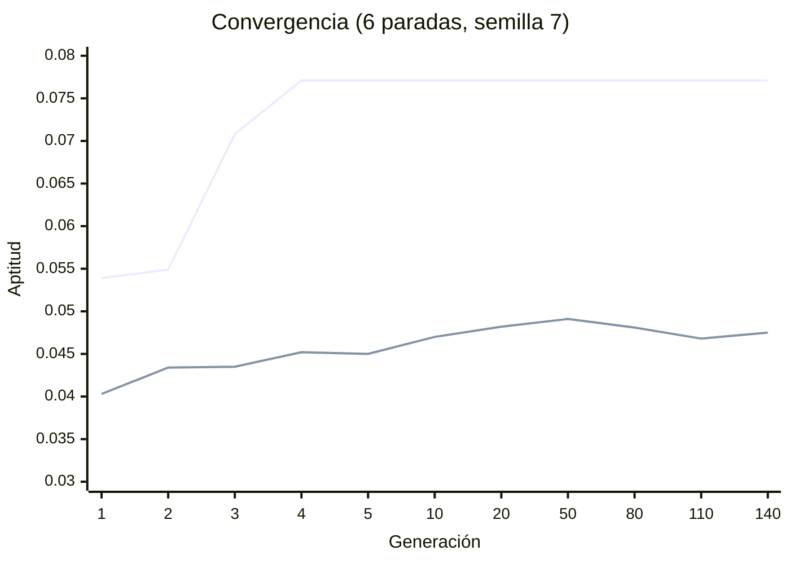

# Manual técnico — Algoritmo genético para ordenar paradas (Kompás v0.6)

> Código: `backend/app/ia/algoritmo_genetico.py` y `backend/app/ia/orden_optimizado.py`
> Pruebas: `backend/tests/test_genetico.py` · Endpoint de apoyo (solo admin): `POST /api/genetico/ordenar-paradas`

## 1. Problema

Dado el punto de salida y las paradas de un plan, ¿en qué orden visitarlas para recorrer la menor distancia?
Es un **agente viajero con origen fijo y sin regreso**. Con *n* paradas hay *n!* órdenes posibles.

En la app se aplica **siempre** en "Armar una salida", después de que el sistema experto decide qué planes
recomendar (`recomendar()`). El genético **no cambia** lo que decidió el sistema experto (lugares, estado,
puntuación, reglas y explicación); solo el orden de visita, y solo si:

1. encuentra un recorrido más corto,
2. no deja más paradas fuera de horario que el orden original, y
3. el itinerario reordenado sigue siendo `recomendable` para `construir_hechos()` + `evaluar()` de Einar.

Con una sola parada no se ejecuta. La respuesta de `POST /api/itinerarios` trae en cada plan
`orden_optimizado: {distancia_antes_km, distancia_despues_km, generaciones, generacion_mejor, aplicado}`
(la app y la web no lo muestran; es para el dashboard y este manual).

## 2. Representación y aptitud

- **Cromosoma:** permutación de los índices de las paradas. `[2, 0, 1]` = ir primero a la parada 2.
- **Aptitud:** `1 / (1 + distancia_total_km + penalización)`
  - `distancia_total_km`: origen → 1.ª parada → … → última, por calles (métrica Manhattan, la misma del planificador).
  - `penalización`: 100 km equivalentes por cada parada que, con la hora de salida y los tiempos estimados de
    `compartido.traslados`, quedaría cerrada durante la visita (`visita_en_horario()` de `hechos.py`).
- Las aptitudes se guardan en caché por cromosoma: con 2–3 paradas solo existen 2–6 órdenes distintos.

## 3. Operadores

| Operador | Implementación |
|---|---|
| Población inicial | El orden original (para no empeorar nunca) + permutaciones al azar |
| Selección | **Torneo** con k = 3: se toman 3 al azar y gana el de mayor aptitud |
| Cruza | **Orden (OX)**: se copia un segmento del padre y se completa con los genes de la madre en su orden |
| Mutación | **Intercambio**: se cambian de lugar dos genes al azar |
| Elitismo | Los 2 mejores pasan tal cual a la siguiente generación |
| Diversidad | Un hijo repetido se muta (hasta 3 veces) para que la población no se estanque |

Ejemplo de cruza OX con el segmento en las posiciones 2–3:

```
padre  = [0 1 | 2 3 | 4 5]        hijo = [_ _ 2 3 _ _]
madre  = [5 3 1 4 0 2]            genes de la madre después del corte, sin repetir: 0 5 1 4
hijo   = [1 4 2 3 0 5]
```

## 4. Parámetros

| Parámetro | Por defecto | Rango en el endpoint |
|---|---|---|
| Población | 60 | 2–500 |
| Generaciones | 150 | 1–2000 |
| Probabilidad de cruza | 0.9 | 0–1 |
| Probabilidad de mutación | 0.2 | 0–1 |
| Torneo (k) | 3 | fijo |
| Elitismo | 2 | fijo |
| Semilla | ninguna (en "Armar una salida": 2026, para que la misma petición dé el mismo orden) | entero |

Con 8 paradas o menos también se calcula el **óptimo por fuerza bruta** (n! permutaciones) y se reporta
`brecha_vs_optimo_%`. En la prueba con 15 casos de 2 a 8 paradas la brecha siempre es ≤ 5 %; en 40 casos
revisados durante el desarrollo la peor fue 0.48 %.

## 5. Resultado de ejemplo y convergencia

`POST /api/genetico/ordenar-paradas` con salida en el Centro de Toluca, 6 paradas y `semilla: 7`:

| | Orden | Distancia |
|---|---|---|
| Original | A → B → C → D → E → F | 24.18 km |
| Genético (generación 4) | F → A → C → B → D → E | **11.97 km** |
| Fuerza bruta | F → A → C → B → D → E | 11.97 km (brecha 0 %) |



La mejor aptitud sube rápido y se queda fija (el elitismo la conserva); el promedio de la población se mantiene
abajo porque la mutación y el control de diversidad siguen probando órdenes nuevos. El dashboard (pestaña
Laboratorio IA) dibuja esta misma gráfica promediando todas las ejecuciones guardadas en `bitacora_laboratorio`
y los **km ahorrados** por tipo de plan en los planes reales.

## 6. Registro

Cada ejecución se guarda en `bitacora_laboratorio` con `tipo: "genetico"`, `origen` (`itinerario` o `endpoint`),
`tipo_plan`, `paradas`, `km_antes`, `km_despues`, `aplicado`, `generaciones`, `generacion_mejor`,
`brecha_vs_optimo_pct`, `historial_mejor`, `historial_promedio` y `ms`. Si la escritura falla, la respuesta se
devuelve igual (solo se anota un aviso en el log).
