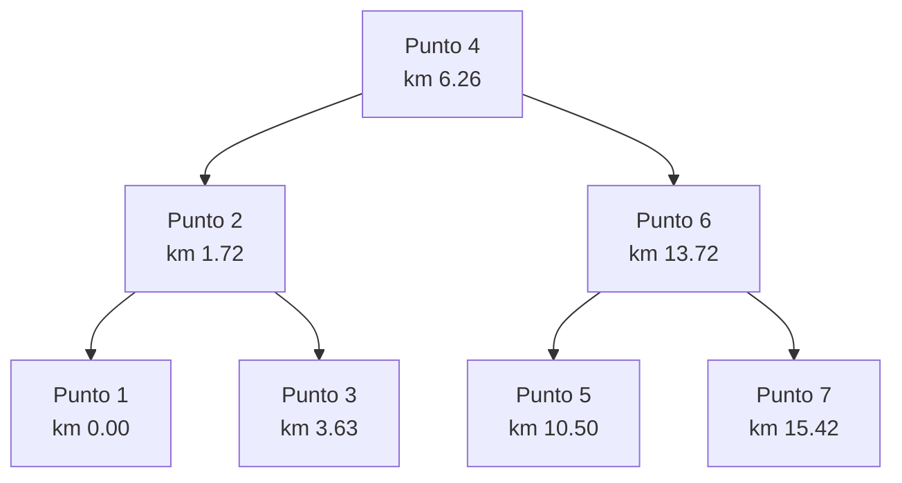

# Manual técnico — Árbol binario de paradas (Kompás v0.6)

> Código: `backend/app/ia/arbol_binario.py` (implementación propia, sin librerías) y `backend/app/ia/trazos.py`
> Pruebas: `backend/tests/test_arbol_binario.py` · Endpoint de apoyo (solo admin): `GET /api/rutas/{id_ruta}/arbol`

## 1. Para qué sirve

En "¿Cómo llego?" hay que decidir **dónde subir** y **dónde bajar** de una ruta. Se proyectan el origen y el
destino sobre el trazo de la ruta, se obtiene el km de cada uno (desde el inicio de la ruta) y se busca la parada
con el km más cercano en un **árbol binario de búsqueda** de las paradas de esa ruta.

En la app, la web y el dashboard **no se dibuja el árbol**: lo que se ve es el resultado en el mapa (dónde subir,
dónde bajar, el tramo en autobús resaltado y las paradas intermedias).

## 2. Estructura

```python
class NodoParada:
    clave: float        # km acumulado desde el inicio de la ruta
    parada: dict        # {id, nombre, lat, lng}
    izquierdo: NodoParada | None   # paradas con menor km
    derecho: NodoParada | None     # paradas con mayor km
```

**Paradas de cada ruta:** se usan las paradas que tenga la ruta en la base (`paradas: [{nombre, ubicacion}]`,
proyectadas sobre el trazo). Si la ruta no tiene paradas, cada punto del trazo es una parada llamada
**"Punto N"**: nunca se inventan nombres de paradas. La respuesta del endpoint lo indica con `paradas_reales: false`.

## 3. Construcción balanceada

Las paradas ya vienen ordenadas por km. Si se insertaran una por una, cada parada nueva sería mayor que todas
las anteriores y quedaría siempre a la derecha: el árbol **degenera en una lista** de altura *n* y buscar cuesta
O(n). La prueba `test_insertar_en_orden_degenera_en_lista` lo comprueba (10 paradas → altura 10).

`construir_balanceado()` usa la **mediana como raíz** y repite en cada mitad:

```text
función ARMAR(paradas[inicio..fin]):
    si inicio > fin: regresar nada
    medio ← ⌈(inicio + fin) / 2⌉
    nodo ← NodoParada(paradas[medio])
    nodo.izquierdo ← ARMAR(paradas[inicio..medio−1])
    nodo.derecho   ← ARMAR(paradas[medio+1..fin])
    regresar nodo
```

Así la altura es **⌈log₂(n + 1)⌉** (probado para n = 1, 2, 3, 4, 7, 8, 15, 16 y 100) y las búsquedas cuestan O(log n).
El árbol de cada ruta se construye una vez y se guarda en memoria; se invalida si cambian el trazo o las paradas
(huella SHA-1 de la ruta).

## 4. Operaciones

| Operación | Qué hace |
|---|---|
| `insertar(clave, parada)` | Inserción clásica de un ABB (menores a la izquierda) |
| `buscar(km)` | La parada con esa clave exacta, o `None` |
| `mas_cercano(km)` | Baja desde la raíz guardando el **predecesor** (mayor clave ≤ km) y el **sucesor** (menor clave ≥ km); regresa el más cercano de los dos y las claves visitadas |
| `rango(desde, hasta)` | Inorden podado: las paradas entre dos km, en orden |
| `inorden` / `preorden` / `postorden` | Recorridos |
| `altura`, `total_nodos`, `a_dict()` | Medidas y JSON `{clave, parada, izquierdo, derecho}` |

## 5. Uso en "¿Cómo llego?"

Para cada opción en autobús (directa o combinada):

1. se proyectan el origen y el destino sobre el trazo y se obtiene su km;
2. `mas_cercano(km)` da la parada de **subida** y la de **bajada** (deben ir en el sentido del trazo y estar a
   ≤ 400 m caminando);
3. `rango(km_subida, km_bajada)` (recorrido inorden) da las **paradas intermedias** y el **tramo en ruta**.

La opción llega a la app con `parada_subida`, `parada_bajada` (`{nombre, lat, lng, km}`), `tramo_en_ruta` y
`paradas_intermedias`; la app pinta el texto "Sube en … / Baja en …" con esos datos.

## 6. Ejemplo: árbol de una ruta

> La base de desarrollo todavía no tiene rutas capturadas por el equipo. Este ejemplo usa un trazo de prueba de
> 7 puntos entre Lerma y el Centro de Toluca (sin paradas reales, por eso "Punto N"). **Pendiente:** regenerarlo
> con `GET /api/rutas/{id}/arbol` cuando haya una ruta real con paradas.



- Altura: 3 = ⌈log₂(7 + 1)⌉ · Total de nodos: 7
- **Inorden:** 0.00, 1.72, 3.63, 6.26, 10.50, 13.72, 15.42 (las paradas en orden de la ruta)
- **Preorden:** 6.26, 1.72, 0.00, 3.63, 13.72, 10.50, 15.42
- **Postorden:** 0.00, 3.63, 1.72, 10.50, 15.42, 13.72, 6.26
- `mas_cercano(8.0)` visita 6.26 → 13.72 → 10.50 y regresa **Punto 4** (8.0 − 6.26 = 1.74 < 10.50 − 8.0 = 2.50).
