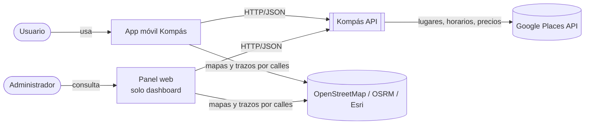
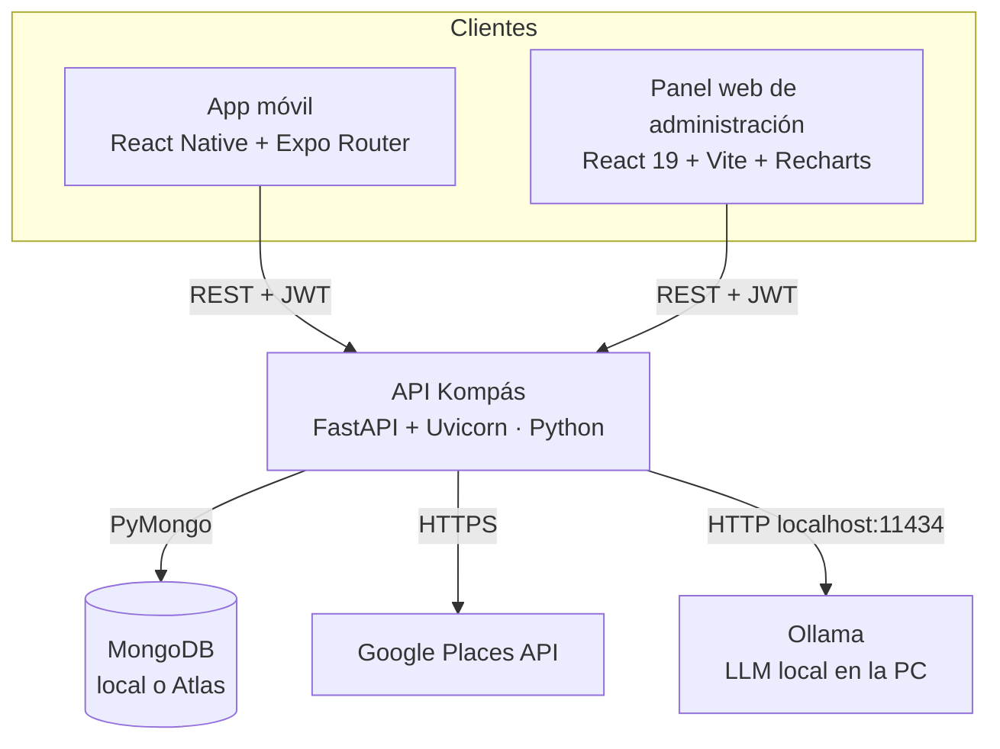
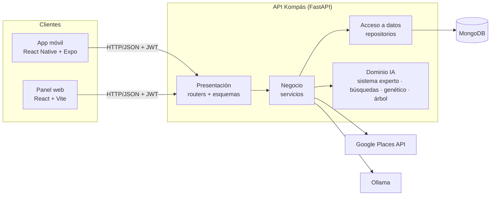
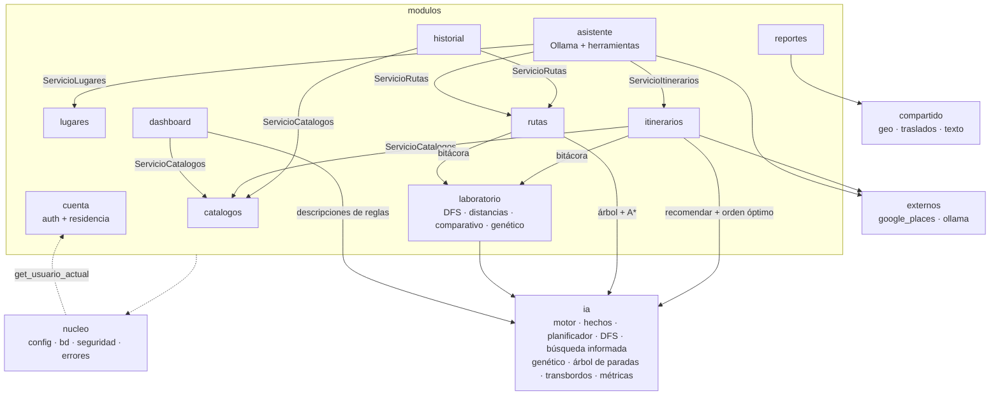
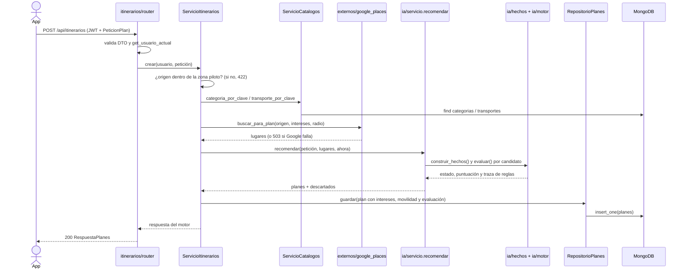
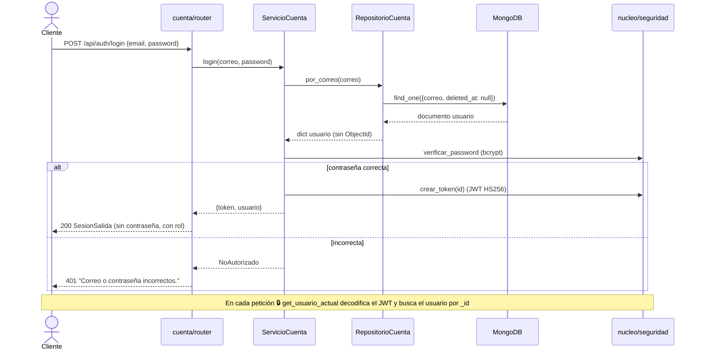
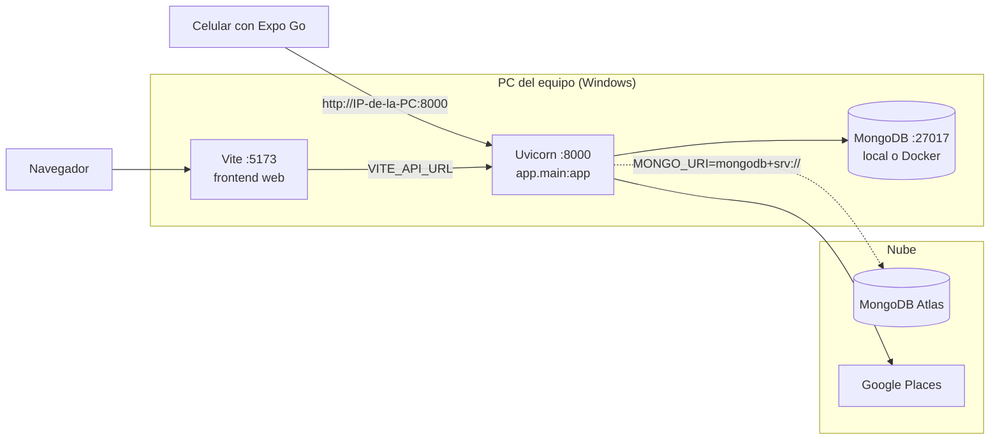

# Manual técnico — Arquitectura de software (Kompás v0.6)

> Fuente: `ARQUITECTURA.md` (raíz del repositorio). Los diagramas están en Mermaid: GitHub y VS Code
> (extensión *Markdown Preview Mermaid Support*) los dibujan directamente.

## 1. Estilo arquitectónico

| Nivel | Estilo | Dónde se ve |
|---|---|---|
| Sistema | **Cliente-servidor** con API REST | La app móvil (Expo) y la web (React) consumen la API FastAPI por HTTP/JSON |
| Backend | **Arquitectura en capas (N capas)** | Presentación → Negocio → Acceso a datos → Infraestructura |
| Organización del código | **Monolito modular** (módulos por funcionalidad) | `backend/app/modulos/<módulo>/` y `frontend/src/modulos/<módulo>/` |

Un monolito modular se despliega como una sola API, pero cada funcionalidad (cuenta, lugares, itinerarios…)
vive en su propia carpeta con sus propias capas. Si un módulo crece, se puede separar como servicio sin reescribirlo.

### Capas y responsabilidades

| Capa | Archivo en cada módulo | Hace | No hace |
|---|---|---|---|
| **Presentación** | `router.py`, `esquemas.py` | Recibe la petición, valida con Pydantic (DTO), pide autenticación, llama al servicio y responde | Consultas a la base, reglas de negocio |
| **Negocio** | `servicio.py` | Reglas del caso de uso: validaciones, orquesta repositorios, IA y servicios externos; lanza errores de negocio | Conocer HTTP (no usa `HTTPException`) ni la base |
| **Acceso a datos** | `repositorio.py` | Lee y escribe en MongoDB; filtra el borrado lógico; convierte documentos a `dict` del dominio | Reglas de negocio, `HTTPException` |
| **Dominio IA** | `app/ia/` | Sistema experto (R01–R20), DFS, UCS, voraz y A\*, algoritmo genético, árbol binario de paradas, transbordos, métricas Euclidiana/Manhattan | Acceso a base o HTTP (es Python puro) |
| **Infraestructura** | `app/nucleo/`, `app/externos/`, `app/compartido/` | Configuración, conexión a MongoDB, JWT/bcrypt, errores, clientes de Google Places y Ollama, geografía | Lógica de un módulo en particular |

### Regla de dependencias

```
router  →  servicio  →  repositorio  →  nucleo.bd (MongoDB)
              │
              ├──→  app.ia (sin cambios de lógica)
              ├──→  app.externos (Google Places, Ollama)
              └──→  servicio de OTRO módulo (nunca su repositorio)
```

1. Un router nunca consulta la base: solo usa `Depends(get_bd)` para construir su servicio.
2. Un repositorio devuelve `dict` o `list[dict]` con las llaves del dominio, nunca documentos crudos con `ObjectId`.
   Gracias a esto el cambio de MySQL a MongoDB no tocó servicios ni routers.
3. Un servicio nunca lanza `HTTPException`: lanza un error de `nucleo/errores.py` (`NoEncontrado`, `Conflicto`,
   `NoAutorizado`, `Prohibido`, `DatosInvalidos`, `ServicioExterno`, `ErrorDeDatos`) y `registrar_manejadores()`
   lo traduce a la respuesta HTTP con el mismo mensaje de siempre.
4. `app/ia/` no importa nada de `modulos/`, de la base ni de FastAPI.

## 2. Patrones de diseño

| Patrón / principio | Dónde | Para qué |
|---|---|---|
| **Repositorio** | `modulos/*/repositorio.py` | Aísla la base de datos; permitió cambiar MySQL → MongoDB sin tocar servicios ni routers |
| **Inyección de dependencias** | `Depends(get_servicio)`, `Depends(get_usuario_actual)`, `Depends(requiere_admin)` | El router recibe el servicio ya construido; en pruebas se puede sustituir |
| **DTO** | `modulos/*/esquemas.py` (Pydantic) | Valida la entrada y define exactamente qué sale en la respuesta (nunca la contraseña) |
| **Fachada** | `app/ia/servicio.recomendar()` | Una sola función esconde hechos + planificador + motor de reglas |
| **Adaptador** | `externos/google_places.py`, `externos/ollama.py` | Convierten la respuesta de Google al formato de lugar que usa la IA y la de Ollama (incluidas las *tool calls*) al formato del asistente |
| **Singleton** | `get_settings()` con `lru_cache`, `nucleo.bd.cliente()` con `lru_cache` | Una sola configuración y un solo pool de conexiones a MongoDB |
| **Middleware / cadena** | `CORSMiddleware`, manejadores de errores | Comportamiento transversal sin repetir código |
| **Sistema experto (encadenamiento hacia adelante)** | `app/ia/motor.py` | Recomienda y explica cada plan con las reglas R01–R20 |
| **Estrategia** | `app/ia/busqueda_informada.py` | UCS, voraz y A\* comparten la misma búsqueda; solo cambia la función f(n) y la heurística |
| **Caché en memoria** | `app/ia/trazos.arbol_de_ruta()` | El árbol de paradas de cada ruta se construye una vez y se invalida si la ruta cambia |
| Principios | Todo el backend | Responsabilidad única, bajo acoplamiento, alta cohesión por módulo |

## 3. Diagramas

### 3.1 Contexto del sistema



El usuario planea salidas desde la app móvil; el administrador revisa estadísticas en el panel web, que solo tiene el dashboard. Ambos clientes
hablan solo con la API de Kompás. La API consulta Google Places para los lugares de un plan (la llave nunca sale
del servidor). Los mosaicos del mapa y el trazo por calles los piden los clientes directamente a servicios abiertos.

### 3.2 Contenedores



Hay cinco piezas que se despliegan por separado (Ollama corre en la misma PC que la API; la app nunca le habla directo). La app y la web son clientes "tontos": no calculan
estadísticas ni reglas, todo lo hace la API. La API es un solo proceso (monolito modular). MongoDB puede ser
local para desarrollo o Atlas en la nube; solo cambia la variable `MONGO_URI`.

### 3.3 Capas del backend



Cada petición entra por la capa de presentación (router), que valida con Pydantic y delega en el servicio.
El servicio aplica las reglas del caso de uso y usa repositorios, la IA o Google. Solo los repositorios hablan
con MongoDB. Las flechas siempre van hacia abajo: una capa nunca llama a la de arriba.

### 3.4 Componentes (módulos del backend)



Cada caja es una carpeta de `backend/app/modulos/` con su router, servicio y repositorio. Cuando un módulo
necesita datos de otro, usa el **servicio** de ese módulo (por ejemplo, historial valida la ruta con
`ServicioRutas`), nunca su repositorio. `nucleo` es infraestructura común; `get_usuario_actual` lee el usuario
con el repositorio de cuenta. `ia` no conoce a nadie: los módulos la llaman a ella.

### 3.5 Secuencia de `POST /api/itinerarios`



El router queda en unas cuantas líneas: valida y delega. El servicio orquesta la zona, los catálogos, Google y la
IA en ese orden, y solo guarda el plan si todo salió bien. La evaluación que se guarda es la misma que regresó
el motor (no se recalcula). El origen exacto del usuario no se guarda por privacidad.

### 3.6 Secuencia de login con JWT



La contraseña se guarda con bcrypt y nunca sale de la API. El token JWT lleva el id del usuario y una fecha de
expiración (`JWT_EXPIRA_MINUTOS`). Los endpoints protegidos reciben el usuario ya validado por inyección de
dependencias; el dashboard además pide `requiere_admin` (rol `admin`).

### 3.7 Despliegue (demostración en red local)



En la demo todo corre en una PC: Uvicorn escucha en `0.0.0.0:8000` para que el celular (Expo Go) entre por la
IP de la red local, y Vite sirve la web. La base puede ser MongoDB local (o en Docker) o Atlas; para Atlas hay
que permitir la IP de la PC en *Network Access*.

### 3.8 Estructura de carpetas

```
backend/app/
├── main.py                    # crea la app, CORS, manejadores de error, registra routers
├── nucleo/                    # config.py · bd.py · seguridad.py · errores.py · parametros.py · esquemas_comunes.py
├── compartido/                # geo.py · traslados.py · texto.py
├── externos/                  # google_places.py (Adaptador)
├── modulos/
│   ├── cuenta/                # router · esquemas · servicio · repositorio
│   ├── catalogos/  lugares/  rutas/  historial/  itinerarios/
│   ├── laboratorio/           # DFS, distancias, comparativo de búsqueda y genético + bitácora
│   ├── reportes/              # nuevo en v0.5
│   ├── dashboard/             # nuevo en v0.5 (solo agregaciones)
│   └── asistente/             # nuevo en v0.6: router · esquemas · servicio · repositorio · herramientas · prompt
└── ia/                        # sistema experto, planificador, DFS, métricas (sin cambios de lógica)
                               # v0.6 (archivos nuevos): busqueda_informada · algoritmo_genetico · orden_optimizado
                               #                        arbol_binario · trazos · transbordos

frontend/src/                  # TypeScript desde la v0.6 (strict, sin any)
├── main.tsx
├── app/                       # App.tsx · Layout.tsx · RutaPrivada.tsx · RutaAdmin.tsx
├── compartido/                # api/ (cliente, lugares, mapas) · tipos/dominio.ts · componentes/ · hooks/ · utils/ · config/
├── mock/                      # datos de ejemplo (VITE_USE_MOCK=true)
└── modulos/
    ├── cuenta/  inicio/  rutas/  itinerarios/  reportes/
    └── dashboard/             # api · tipos · mock · hooks · paginas · componentes · graficas (28 gráficas y paneles)
```

## 4. App móvil (`app/`)

No se reorganizó: Expo Router obliga a que las pantallas vivan en `src/app/`. Ya sigue una separación en
capas equivalente:

| Capa | Carpeta |
|---|---|
| Presentación (pantallas y navegación) | `src/app/` (Expo Router) |
| Componentes de interfaz | `src/components/` |
| Estado global | `src/context/` (Sesión, Tema, Ubicación, Viaje) |
| Acceso a la API | `src/services/api.ts` (+ `mock/`) |
| Modelo de dominio (tipos) | `src/types/dominio.ts` |

## 5. Frontend web: reglas de módulos

1. `compartido/api/cliente.js` tiene `solicitud()`, la sesión y `ErrorApi`; cada endpoint vive en el `api.js` de su
   módulo con el mismo nombre, firma y JSDoc que antes. Con `VITE_USE_MOCK=true` responden los datos de ejemplo.
2. Un módulo importa de `compartido/` libremente, pero de otro módulo solo a través de su `index.js`
   (por ejemplo `import { useAuth } from '../cuenta'`).
3. Las páginas nunca llaman `fetch` directo.
4. La web es **solo el panel de administración**: login y dashboard en `/`. Las rutas, itinerarios y reportes para
   usuarios viven en la app móvil; los módulos `inicio`, `rutas`, `itinerarios` y `reportes` de la web ya no están
   en el enrutador. El login rechaza cuentas que no son admin.
