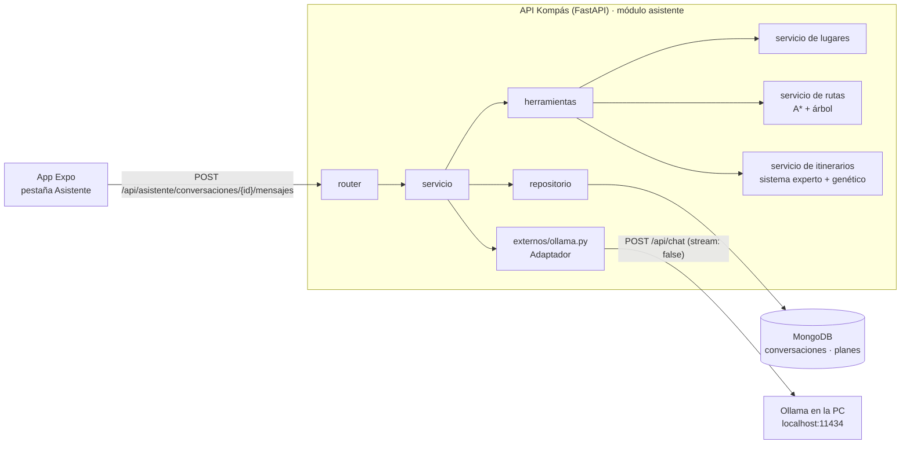
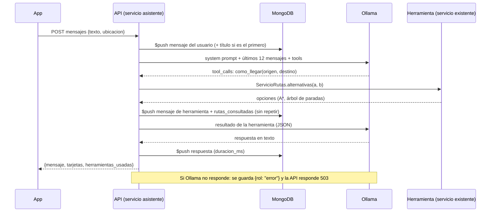

# Manual técnico — Asistente con LLM local (Ollama) (Kompás v0.6)

> Código: `backend/app/modulos/asistente/` y `backend/app/externos/ollama.py`
> App: `app/src/app/(tabs)/asistente/` · Pruebas: `backend/tests/test_asistente.py` (con Ollama simulado)

## 1. Arquitectura



- La app **nunca** llama a Ollama: todo pasa por la API (el celular usa `EXPO_PUBLIC_API_URL=http://<IP de la PC>:8000`
  y la API habla con `OLLAMA_URL=http://localhost:11434` en la misma PC).
- `externos/ollama.py` es un **Adaptador** (como Google Places): `chat()` con `httpx`, timeout 60 s,
  `options: {temperature: 0.3, num_ctx: 4096}`, y `estado()` que hace ping a `/api/tags`.
- Modelo por defecto `OLLAMA_MODELO=llama3.2:3b` (soporta *tools*). Se cambia en `backend/.env`.
- Los modelos chicos a veces escriben la llamada a la herramienta como JSON en el texto; el adaptador la reconoce
  (solo si es una herramienta conocida). Si el modelo no soporta *tools*, el servicio responde solo con texto y lo
  anota en el log.

## 2. Herramientas (tool calling)

| Herramienta | Llama a | Para qué |
|---|---|---|
| `buscar_lugares(texto, categoria?)` | `ServicioLugares` (y Google Places Text Search si no hay en la base) | "¿Dónde hay un café cerca?" |
| `como_llegar(origen, destino, medios?)` | `ServicioRutas.alternativas()` | "¿Cómo llego al Cosmovitral desde la terminal?" |
| `armar_salida(contexto, presupuesto, tiempo, intereses, hora_salida, movilidad?)` | `ServicioItinerarios.crear_y_guardar()` | "Plan con amigos, 300 pesos, 3 horas" |
| `mis_planes()` | `ServicioItinerarios.del_usuario()` | "¿Qué planes he guardado?" |

- Las herramientas usan los **servicios existentes** (no duplican lógica) y le regresan al modelo JSON.
- Un texto como "la terminal" se ubica primero en la colección `lugares` y luego con Google Places (Text Search,
  restringido a la zona piloto). "Mi ubicación" usa la ubicación que manda la app en el mensaje. Si no se encuentra,
  la herramienta responde que no se encontró y el modelo debe decirlo (no se inventan coordenadas ni rutas).
- Máximo **3 llamadas** a herramientas por mensaje; después el modelo debe contestar con lo que tiene.
- Cuando `armar_salida` crea un plan, se guarda en `planes` como cualquier plan, con `origen_solicitud: "asistente"`,
  así aparece en *Mis planes* y en el dashboard.

## 3. Secuencia de un mensaje



## 4. Endpoints (todos 🔒; cada usuario solo ve lo suyo)

| Método | Ruta | Descripción |
|---|---|---|
| `GET` | `/api/asistente/estado` | `{disponible, modelo, modelo_instalado}` (ping a Ollama) |
| `POST` | `/api/asistente/conversaciones` | Crea una conversación vacía |
| `GET` | `/api/asistente/conversaciones` | Lista: id, título, último mensaje, fecha, total de mensajes |
| `GET` | `/api/asistente/conversaciones/{id}` | Conversación completa |
| `POST` | `/api/asistente/conversaciones/{id}/mensajes` | `{texto, ubicacion?}` → respuesta y tarjetas (rutas/planes) |
| `DELETE` | `/api/asistente/conversaciones/{id}` | Borrado lógico |

- Ollama no responde → **503** "El asistente no está disponible en este momento." (el mensaje del usuario sí se guarda).
- `{id}` de otro usuario (o que no existe) → **404**, sin revelar que existe.
- Más de 2000 caracteres → **422**.

## 5. Colección `conversaciones`

```json
{
  "_id": "ObjectId",
  "id_usuario": 1,
  "titulo": "¿Cómo llego al Cosmovitral…",
  "modelo": "llama3.2:3b",
  "mensajes": [
    { "rol": "usuario", "contenido": "¿Cómo llego al Cosmovitral desde la terminal?", "creado_en": "fecha" },
    { "rol": "herramienta", "nombre": "como_llegar", "argumentos": {"origen": "la terminal", "destino": "Cosmovitral"},
      "resultado_ref": { "tipo": "ruta", "id_ruta": 2, "origen": "la terminal", "destino": "Cosmovitral" }, "creado_en": "fecha" },
    { "rol": "asistente", "contenido": "Puedes tomar…", "duracion_ms": 4200, "creado_en": "fecha" },
    { "rol": "error", "contenido": "El asistente no está disponible en este momento.", "creado_en": "fecha" }
  ],
  "rutas_consultadas": [ { "id_ruta": 2, "origen": "la terminal", "destino": "Cosmovitral", "transporte": "autobus", "consultado_en": "fecha" } ],
  "planes_creados": [ 31 ],
  "created_at": "fecha", "updated_at": "fecha", "deleted_at": null
}
```

- Índices: `{id_usuario: 1, updated_at: -1}` y `{created_at: 1}`. Validador `$jsonSchema` en `scripts/preparar_bd.py`.
- Los mensajes se agregan con `$push`; las rutas consultadas sin repetir (mismo id, origen, destino y transporte);
  los planes con `$addToSet`.
- El título se genera de las primeras 6 palabras del primer mensaje (sin llamar al LLM).
- **Privacidad:** no se guarda la ubicación del usuario ni datos de Google (en `resultado_ref` van los textos que
  escribió el usuario). El dashboard solo muestra datos agregados, nunca el contenido de los mensajes.

## 6. System prompt (`modulos/asistente/prompt.py`)

Resumen de lo que deja claro:

- Es el asistente de Kompás para **Toluca, Lerma y San Mateo Atenco**; responde en español y breve.
- Solo usa datos de las herramientas. Si no hay información verificada de una ruta, un horario o una tarifa, lo
  dice en lugar de inventarla (misma regla que `CONTEXTO.md` §2). Los tiempos son estimaciones.
- Fuera de movilidad y salidas en la zona, redirige amablemente.
- Nunca pide ni muestra contraseñas ni datos de otros usuarios.
- Incluye la fecha y la hora actuales de Toluca (para `hora_salida`).

## 7. Cómo correrlo

1. Instalar Ollama y descargar el modelo: `ollama pull llama3.2:3b` (si ya tienes `llama3.2:latest` es el mismo
   modelo; puedes poner `OLLAMA_MODELO=llama3.2:latest` en `backend/.env`).
2. Con Ollama abierto, levantar la API y probar `GET /api/asistente/estado` → `{"disponible": true, ...}`.
3. La primera respuesta tarda más (Ollama carga el modelo en memoria); la app espera hasta 120 s.
