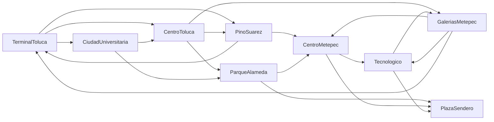

# Manual técnico — Búsqueda informada y heurísticas (Kompás v0.6)

> Código: `backend/app/ia/busqueda_informada.py` · Pruebas: `backend/tests/test_busqueda_informada.py`
> Endpoint de apoyo (solo admin): `GET /api/busqueda/comparar?origen=&destino=`

Kompás tenía una búsqueda **no informada** (DFS, `busqueda_dfs.py`). En la v0.6 se agregan tres búsquedas sobre
**el mismo grafo** (se importa, no se copia): costo uniforme (UCS), voraz o "primero el mejor" y A\*. Las cuatro
regresan la misma forma de respuesta: camino, traza paso a paso y nodos explorados.

## 1. El grafo



Es la red académica del DFS (9 nodos, 19 aristas dirigidas, con ciclos). **No es una red operativa**: sus
conexiones no están verificadas y toda respuesta lo indica con `datos_verificados: false`.

- **Costo de una arista, g:** distancia en km entre los dos nodos, con sus coordenadas. Los `tiempo_min` del grafo
  no se usan (no están verificados y están en otra unidad). Si una arista trae `costo`, se usa ese valor.
- **Coordenadas:** el grafo ya las trae (`PARADAS_KOMPAS`), así que no fue necesario `coordenadas_grafo.json`.
- **Proyección a km** (equirectangular local centrada en el Centro de Toluca, lat₀ = 19.2926, lng₀ = −99.6557):

  ```
  x = (lng − lng₀) · 111.320 · cos(lat₀)        y = (lat − lat₀) · 110.574
  ```

  En la zona piloto la diferencia con haversine es menor a 0.1 %.

## 2. Algoritmos

Los tres usan una **cola de prioridad** (montículo, `heapq`) ordenada por f(n). Solo cambia f:

| Algoritmo | f(n) | Idea |
|---|---|---|
| Costo uniforme (UCS) | g(n) | Expande el nodo con menor costo acumulado. Siempre óptimo. |
| Voraz (primero el mejor) | h(n) | Expande el que "parece" más cerca del destino. Rápido, no garantiza el óptimo. |
| A\* | g(n) + h(n) | Combina lo recorrido y lo que falta. Óptimo si h es admisible. |

```text
función BUSCAR(origen, destino, f):
    g[origen] ← 0;  padre[origen] ← nada
    frontera ← cola de prioridad con (f(origen), origen)
    explorados ← ∅
    mientras frontera no esté vacía:
        n ← sacar el de menor f de la frontera
        si n ∈ explorados: continuar            # entrada vieja
        agregar n a explorados; anotar paso (n, g, h, f, frontera ordenada)
        si n = destino: regresar camino(padre, destino)
        para cada arista n → v:
            si v ∈ explorados: continuar
            g' ← g[n] + costo(n, v)
            si VORAZ y v ya se descubrió: continuar     # voraz no reabre nodos
            si UCS/A* y g' ≥ g[v]: continuar
            g[v] ← g';  padre[v] ← n
            meter (f(v), v) a la frontera
    regresar "sin camino"
```

Con `origen = destino` el camino es de un solo nodo y costo 0.

### Heurísticas

h(n) es la distancia del nodo n al destino con las funciones de `metricas_distancia.py` sobre el plano en km:

- **Euclidiana:** √(Δx² + Δy²)
- **Manhattan:** |Δx| + |Δy|

## 3. Admisibilidad

Una heurística es **admisible** si nunca sobreestima el costo real que falta: h(n) ≤ h\*(n).

- **Euclidiana: admisible.** El costo de cada arista es su distancia en línea recta, y ningún camino es más corto
  que la línea recta (desigualdad del triángulo). Por eso **A\* con Euclidiana siempre da el óptimo**
  (`es_admisible: true`). También es *consistente*, así que A\* nunca necesita reabrir un nodo.
- **Manhattan: no admisible.** |Δx| + |Δy| ≥ √(Δx² + Δy²), y llega a ser 1.41 veces mayor en diagonal. Puede
  sobreestimar, así que A\* con Manhattan **puede devolver un camino que no es el óptimo** (`es_admisible: false`).

El comparativo lo muestra con datos: calcula h\*(n) con Dijkstra sobre el grafo invertido y lista los nodos donde
h(n) > h\*(n). Para el destino *Plaza Sendero* la Manhattan sobreestima en 4 nodos:

| Nodo | h Manhattan (km) | Costo real h\* (km) | Sobreestima por |
|---|---|---|---|
| CentroMetepec | 11.446 | 8.416 | 3.030 |
| GaleriasMetepec | 13.531 | 10.803 | 2.728 |
| Tecnologico | 8.681 | 6.273 | 2.408 |
| CiudadUniversitaria | 15.442 | 14.988 | 0.455 |

## 4. Tabla comparativa real

Salida de `GET /api/busqueda/comparar?origen=TerminalToluca&destino=PlazaSendero` (costo óptimo 13.608 km):

| Algoritmo | Heurística | Costo (km) | Nodos explorados | Aristas | ¿Óptimo? | Camino |
|---|---|---|---|---|---|---|
| DFS (primer camino) | — | 17.343 | 57 | 5 | No | Terminal → Centro → Pino Suárez → Centro Metepec → Tecnológico → Sendero |
| UCS | — | 13.608 | 9 | 3 | Sí | Terminal → Pino Suárez → Centro Metepec → Sendero |
| Voraz | Euclidiana | 13.608 | 4 | 3 | Sí | Terminal → Pino Suárez → Centro Metepec → Sendero |
| Voraz | Manhattan | 13.608 | 4 | 3 | Sí | Terminal → Pino Suárez → Centro Metepec → Sendero |
| A\* | Euclidiana | 13.608 | 4 | 3 | Sí | Terminal → Pino Suárez → Centro Metepec → Sendero |
| A\* | Manhattan | **16.404** | 5 | 3 | **No** | Terminal → Centro → Alameda → Sendero |

DFS explora 57 nodos porque recorre **todos** los caminos (backtracking); el primero que encuentra no es el más corto.

Promedio sobre las **64 parejas origen–destino con camino** de la red:

| Algoritmo | Heurística | Nodos explorados (promedio) | Veces óptimo | Costo ÷ óptimo |
|---|---|---|---|---|
| DFS (primer camino) | — | 23.8 | 58 % | 1.683 |
| UCS | — | 5.5 | 100 % | 1.000 |
| Voraz | Euclidiana | 3.4 | 88 % | 1.026 |
| Voraz | Manhattan | 3.4 | 88 % | 1.025 |
| A\* | Euclidiana | 3.4 | **100 %** | **1.000** |
| A\* | Manhattan | 3.4 | 95 % | 1.005 |

Conclusión para el manual: A\* con Euclidiana explora tan pocos nodos como el voraz y siempre da el óptimo, igual
que UCS. La Manhattan, al no ser admisible, falla en 3 de las 64 parejas.

### Traza de A\* (Euclidiana), Terminal → Plaza Sendero

| Paso | Nodo expandido | g | h | f | Frontera ordenada por f (después de expandir) |
|---|---|---|---|---|---|
| 1 | TerminalToluca | 0 | 11.668 | 11.668 | PinoSuarez (11.847), CentroToluca (14.580), CiudadUniversitaria (18.188) |
| 2 | PinoSuarez | 1.210 | 10.637 | 11.847 | CentroMetepec (13.608), CentroToluca (14.580), CiudadUniversitaria (18.188) |
| 3 | CentroMetepec | 5.192 | 8.416 | 13.608 | PlazaSendero (13.608), Tecnologico (13.668), CentroToluca (14.580), CiudadUniversitaria (18.188) |
| 4 | PlazaSendero | 13.608 | 0 | 13.608 | (objetivo) |

## 5. Dónde se usa dentro de la app

No hay pantalla de "laboratorio" para el usuario. A\* con heurística Euclidiana trabaja **por dentro** de
"¿Cómo llego?" para encontrar combinaciones con transbordo (`app/ia/transbordos.py`, ver `ia-en-la-app.md`).
El comparativo solo lo ven los administradores en el dashboard (pestaña Laboratorio IA).
