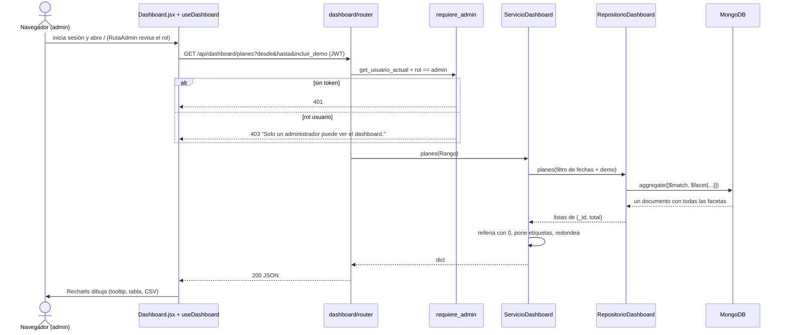

# Manual técnico — Dashboard de estadísticas (Kompás v0.6)

> Fuente: `DASHBOARD.md`. Backend: `backend/app/modulos/dashboard/`. Web: `frontend/src/modulos/dashboard/`.

El **panel web** (`frontend/`, ruta `/`) es solo el dashboard: muestra cómo se usa Kompás y cómo decide la IA. Solo la ven usuarios con
`rol: "admin"`. **Todas las cifras salen de agregaciones de MongoDB calculadas en la API**; la web solo dibuja
(Recharts, un mapa de calor en CSS grid y un mapa con react-leaflet).

## 1. Secuencia de una consulta



La web pide los 8 endpoints en paralelo al cambiar los filtros. El router no hace consultas: valida el rol
(dependencia a nivel de router), arma el `Rango` y delega. El repositorio solo contiene pipelines; el servicio
rellena huecos con cero para que las gráficas no tengan saltos.

## 2. Endpoints

Todos aceptan `desde` y `hasta` (`YYYY-MM-DD`, opcionales; por defecto los últimos 30 días; `hasta` incluye el
día completo) e `incluir_demo` (bool, por defecto `true`). Zona horaria fija: `America/Mexico_City`.
Filtro base: `{"deleted_at": None, "created_at": {"$gte": desde, "$lt": hasta + 1 día}}` y, con
`incluir_demo=false`, `{"demo": {"$ne": True}}`. Cada respuesta trae `periodo` e `incluye_demo`.

| Ruta | Colecciones | Devuelve |
|---|---|---|
| `GET /api/dashboard/kpis` | todas | `usuarios_totales`, `usuarios_nuevos`, `planes`, `planes_evaluados`, `porcentaje_con_recomendacion`, `recorridos`, `tiempo_promedio_recorrido_min`, `reportes_vigentes`, `lugares` |
| `GET /api/dashboard/series?agrupar=dia\|semana\|mes` | usuarios, planes, historial_rutas | `serie: [{fecha, usuarios, planes, recorridos}]`, `planes_por_interes: [{fecha, comer, cafe, cultura, entretenimiento, aire_libre}]` |
| `GET /api/dashboard/planes` | planes | `por_interes`, `por_movilidad`, `por_contexto`, `presupuesto` (histograma), `tiempo_disponible` (histograma), `dia_hora` (7 × 24), `interes_por_contexto` (radar) |
| `GET /api/dashboard/sistema-experto` | planes | `por_estado`, `reglas_top` (id, descripción, total), `puntuacion_por_tipo` (promedio, mín, máx), `sin_datos_suficientes`, `por_version` |
| `GET /api/dashboard/movilidad` | historial_rutas | `por_transporte` (total, promedio, mín, máx de `tiempo_estimado`), `rutas_top` |
| `GET /api/dashboard/reportes` | reportes | `por_tipo_estado`, `vigentes_vs_vencidos`, `puntos` (máx. 500: lat, lng, tipo, estado, vigente) |
| `GET /api/dashboard/lugares` | lugares | `por_categoria`, `puntos` (id, nombre, lat, lng, categoría). Catálogo completo, sin filtro de fechas |
| `GET /api/dashboard/laboratorio` | bitacora_laboratorio | `dfs_puntos` (límite, nodos, rutas, consultas), `dfs_pares_top`, `distancias_puntos` (euclidiana, manhattan) |

Las descripciones de las reglas se leen con `app.ia.motor.cargar_base()` (solo lectura; `app/ia/` no se modifica).

## 3. Pipelines explicados etapa por etapa

### 3.1 Serie por periodo (`series`)

```python
[
    {"$match": filtro},
    {"$group": {
        "_id": {"$dateTrunc": {"date": "$created_at", "unit": "day", "timezone": "America/Mexico_City"}},
        "total": {"$sum": 1},
    }},
    {"$sort": {"_id": 1}},
]
```

- **`$match`** deja pasar solo los documentos del periodo, activos y (si se pidió) sin `demo: true`.
  Va primero para aprovechar el índice `created_at`.
- **`$dateTrunc`** "recorta" cada fecha al inicio de su día, semana (lunes) o mes **en hora de Toluca**, así un
  registro de las 23:30 no cae en el día siguiente por estar en UTC.
- **`$group`** junta todos los documentos con el mismo inicio de periodo y **`$sum: 1`** los cuenta.
- **`$sort`** ordena cronológicamente. El servicio después crea los periodos que faltan con 0.

### 3.2 Planes (una sola consulta con `$facet`)

```python
[
    {"$match": filtro},
    {"$facet": {
        "por_interes":   [{"$unwind": "$intereses"}, {"$group": {"_id": "$intereses", "total": {"$sum": 1}}}],
        "por_movilidad": [{"$unwind": "$movilidad"}, {"$group": {"_id": "$movilidad", "total": {"$sum": 1}}}],
        "por_contexto":  [{"$group": {"_id": "$contexto", "total": {"$sum": 1}}}],
        "presupuesto":   [{"$bucket": {"groupBy": "$presupuesto.max",
                                       "boundaries": [0, 100, 200, 300, 500, 800, 1200],
                                       "default": "1200+", "output": {"total": {"$sum": 1}}}}],
        "tiempo_disponible": [{"$bucket": {"groupBy": "$tiempo_disponible",
                                           "boundaries": [0, 60, 120, 180, 240, 360, 480], "default": "8h+"}}],
        "dia_hora": [{"$group": {"_id": {"dia": {"$isoDayOfWeek": {"date": "$fecha_plan", "timezone": TZ}},
                                          "hora": {"$hour": {"date": "$fecha_plan", "timezone": TZ}}},
                                  "total": {"$sum": 1}}}],
        "interes_por_contexto": [{"$unwind": "$intereses"},
                                 {"$group": {"_id": {"contexto": "$contexto", "interes": "$intereses"},
                                             "total": {"$sum": 1}}}],
    }},
]
```

- **`$facet`** corre varios sub-pipelines sobre los **mismos** documentos filtrados y regresa un solo documento
  con una lista por faceta: una ida a la base en lugar de siete.
- **`$unwind`** "desenrolla" un arreglo: un plan con `intereses: ["comer", "cafe"]` se vuelve dos documentos, uno
  por interés, para poder contar cada interés por separado.
- **`$bucket`** reparte valores numéricos en rangos (`[0, 100)`, `[100, 200)`, …); lo que queda fuera cae en
  `default`. Así se arma el histograma sin traer los planes a Python.
- **`$isoDayOfWeek`** y **`$hour`** extraen día (1 = lunes) y hora en hora de Toluca para el mapa de calor.
- Agrupar por un `_id` compuesto (`{contexto, interes}`) da la tabla cruzada del radar.

### 3.3 Sistema experto

```python
[
    {"$match": {**filtro, "evaluacion": {"$exists": True}}},
    {"$unwind": "$evaluacion.candidatos"},
    {"$facet": {
        "por_estado": [{"$group": {"_id": "$evaluacion.candidatos.estado", "total": {"$sum": 1}}}],
        "reglas_top": [{"$unwind": "$evaluacion.candidatos.reglas"},
                       {"$group": {"_id": "$evaluacion.candidatos.reglas", "total": {"$sum": 1}}},
                       {"$sort": {"total": -1}}, {"$limit": 20}],
        "puntuacion_por_tipo": [{"$match": {"evaluacion.candidatos.puntuacion": {"$ne": None}}},
                                {"$group": {"_id": "$evaluacion.candidatos.tipo",
                                            "promedio": {"$avg": "$evaluacion.candidatos.puntuacion"},
                                            "minimo": {"$min": "$evaluacion.candidatos.puntuacion"},
                                            "maximo": {"$max": "$evaluacion.candidatos.puntuacion"}}}],
    }},
]
```

- Un primer **`$unwind`** separa los candidatos de cada plan (equilibrado, rápido, cercano); un segundo
  `$unwind` dentro de `reglas_top` separa cada regla activada para contarla.
- **`$avg`, `$min`, `$max`** calculan promedio y rango de la puntuación solo de los recomendables
  (`puntuacion != null`). **`$limit`** deja las 20 reglas más usadas.

### 3.4 Movilidad, reportes, lugares y laboratorio

- **Movilidad**: `$group` por `transporte.nombre` con `$sum`, `$avg`, `$min` y `$max` de `tiempo_estimado`
  (gracias a la referencia extendida no hace falta un `$lookup`), y otro grupo por `id_ruta` para las más usadas.
- **Reportes**: `$facet` con `$group` por `{tipo, estado}` y `$cond: [{$gt: ["$vigente_hasta", ahora]}, 1, 0]`
  para separar vigentes de vencidos; `$project` con `$arrayElemAt` saca lat/lng del GeoJSON para el mapa.
- **Lugares**: `$group` por `categoria.nombre` (treemap) y `$project` de los puntos.
- **Laboratorio**: `$group` por `{limite_profundidad, total_nodos_explorados}` con `$avg` de rutas y `$sum` de
  consultas (burbujas), y por `{origen, destino}` para los pares más consultados.

## 4. Control de acceso por rol

- `rol` vive en `usuarios` (`usuario` por defecto). La API lo regresa en el login y en `/api/auth/yo`.
- Backend: el router del dashboard declara `dependencies=[Depends(requiere_admin)]`; sin token responde 401 y con un
  usuario normal 403 `"Solo un administrador puede ver el dashboard."`.
- Web: el login rechaza cuentas que no son admin ("Esta cuenta no es de administrador…") y `app/RutaAdmin.jsx`
  muestra *Sin acceso al panel* si una sesión guardada no es admin. El menú solo tiene **Dashboard**.
  (La protección real es la de la API; la de la web solo evita mostrar algo que no se puede usar.)
- Crear un admin:

  ```powershell
  python -m scripts.crear_admin correo@dominio.com            # da rol admin
  python -m scripts.crear_admin correo@dominio.com --quitar   # lo regresa a usuario
  ```

  El usuario demo (`demo@kompas.mx`) ya viene con rol admin en `datos_desarrollo.json`.

## 5. Datos de demostración

Con una base recién creada las gráficas salen vacías. `scripts/sembrar_actividad_demo.py` genera actividad
**sintética marcada con `demo: true`** (semilla fija `random.seed(28)`, reproducible):

```powershell
python -m scripts.sembrar_actividad_demo --dias 60 --usuarios 40 --planes 300   # genera
python -m scripts.sembrar_actividad_demo --borrar                               # borra todo lo demo
```

- Usuarios `demo+N@kompas.mx` con contraseña aleatoria, planes variados cuya `evaluacion` sale del **motor real**
  (`app.ia.servicio.recomendar()` con los lugares genéricos de la base y el horario de `backend/ejemplos/`),
  recorridos sobre rutas existentes (si no hay, crea rutas demo), reportes dentro de la zona piloto y consultas
  de DFS y distancias en la bitácora con resultados reales de `app/ia/`.
- En el dashboard aparece **"Incluye datos de demostración"** y el interruptor **Incluir datos demo** permite
  ver solo la actividad real.

## 6. Interfaz web

| Pestaña | Gráficas |
|---|---|
| Resumen | 6 KPI · medidor de % con recomendación (`RadialBarChart`) · actividad en el tiempo (`LineChart`) · intereses en el tiempo (`AreaChart` apilada) |
| Planes | por interés (`BarChart`) · contexto (dona) · movilidad (barras horizontales con colores de transporte) · presupuesto y tiempo disponible (histogramas) · día × hora (mapa de calor CSS grid) · perfil por contexto (`RadarChart`) |
| Sistema experto | estados (`PieChart`) · reglas más activadas con descripción en el tooltip · puntuación por tipo (`ComposedChart` + `ErrorBar`) |
| Movilidad | recorridos por transporte + tiempo promedio (`ComposedChart`, doble eje) · rutas más usadas |
| Reportes y lugares | reportes por tipo y estado (barras apiladas) · lugares por categoría (`Treemap`) · mapa con capas activables |
| Laboratorio IA | DFS nodos vs. límite (burbujas) · Euclidiana vs. Manhattan con `y = x` · pares DFS más consultados |

Cada gráfica tiene título, una línea que explica qué se ve, tooltip en español, números con
`Intl.NumberFormat('es-MX')`, estado vacío ("Sin datos en este periodo"), **Ver como tabla** (alternativa accesible)
y **Descargar CSV** (mismos datos, generado en el navegador). Colores solo de `COLORIMETRIA.md` vía los tokens de
`index.css` (funcionan en claro y oscuro); el color nunca es el único medio para distinguir series: hay leyenda,
etiquetas y la tabla. Con `VITE_USE_MOCK=true` el dashboard usa `mock.js` (misma forma que la API).

## 7. Ampliación v0.6

| Pestaña | Panel | Datos |
|---|---|---|
| Laboratorio IA | Nodos explorados por algoritmo (barras agrupadas DFS / UCS / voraz / A\*, una barra por heurística) | En vivo de `GET /api/busqueda/comparar` con el par que elija el administrador |
| Laboratorio IA | Costo del camino vs. óptimo (costo ÷ óptimo, línea en 1) | `busqueda_algoritmos` de `/api/dashboard/laboratorio` (corridas guardadas) |
| Laboratorio IA | Convergencia del genético (mejor y promedio de aptitud por generación) | `genetico_convergencia`: `$unwind` de `historial_mejor` con `includeArrayIndex` |
| Laboratorio IA | Km ahorrados por el genético (antes y después, por tipo de plan) | `genetico_ahorro`: planes reales (`origen: "itinerario"`) |
| Laboratorio IA | Transbordos con A\* (búsquedas, encontrados, nodos explorados y ms promedio) | `transbordos` |
| Movilidad | **Rutas y paradas**: trazo de la ruta elegida con sus paradas numeradas en orden (inorden del árbol) y círculos de las paradas donde más se sube y se baja | `GET /api/rutas`, `GET /api/rutas/{id}/arbol` y `paradas_uso` de `/api/dashboard/movilidad` (registros `abordaje`) |
| Asistente (nueva) | Conversaciones y mensajes por día, herramientas más usadas, tiempo de respuesta (promedio y p90), % sin respuesta y planes por origen (dona) | `GET /api/dashboard/asistente`; **nunca** el contenido de los mensajes |

Todos los campos nuevos de `laboratorio` y `movilidad` son opcionales: la respuesta de la v0.5 no cambia. El p90
se calcula en el servicio (interpolación lineal) sobre las últimas 5000 duraciones. `scripts/sembrar_actividad_demo.py`
también genera corridas reales del comparativo, del genético sobre los planes demo, de "¿Cómo llego?" (subidas,
bajadas y transbordos con el servicio real) y conversaciones con texto genérico, todo con `demo: true`.

La web del dashboard está en **TypeScript** (`tipos.ts` tiene la forma de cada respuesta de `/api/dashboard/*`).
