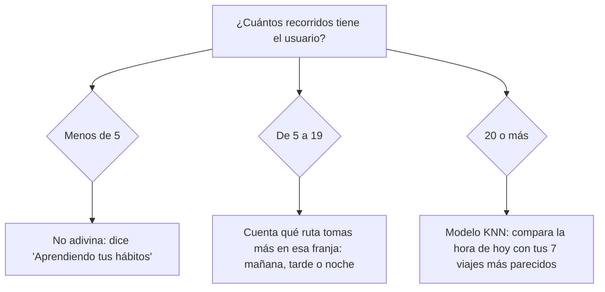
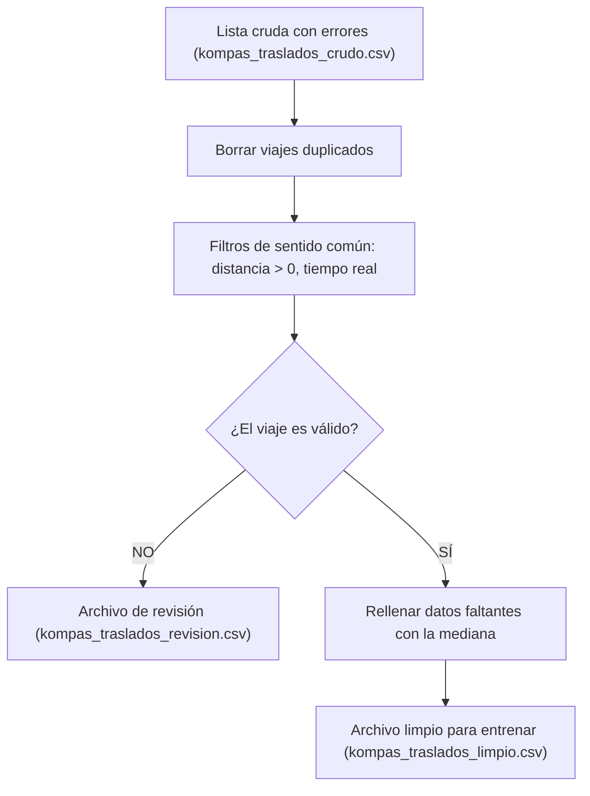

# Implementación de Machine Learning e IA para el Equipo de Kompás

> **¿Qué es este documento?**
> Explica con palabras sencillas cómo funciona el machine learning que le añadimos a Kompás. No necesitas ser programador ni experto en matemáticas para entenderlo.
> Versión técnica: `implementacion ML tecnico.md`.

---

## En resumen: qué hicimos, cómo y dónde

**¿Qué hicimos?**
Cambiamos el "cerebro" de la pestaña **Asistente**. Antes era un chat que dependía de un programa pesado (Ollama). Ahora es un asistente que **aprende de los viajes que haces en la app** y te dice a dónde sueles ir a cada hora, por ejemplo: *"A esta hora sueles ir a la UTVT"*.

**¿Cómo funciona, en tres pasos?**
1. **Anota:** cada vez que eliges una ruta en autobús, Kompás anota cuál fue, qué día y a qué hora.
2. **Aprende:** con esas notas busca tus costumbres ("los martes a las 7 casi siempre va a la UTVT").
3. **Te sugiere:** cuando abres la app, compara la hora de ahora con tus costumbres y te dice a dónde vas probablemente.

**¿Dónde lo ves?**
* En la pestaña **Asistente**, la pantalla completa: la sugerencia, cómo la calculó y tus hábitos.
* En **Inicio**, una tarjeta rápida con la sugerencia.
* En **Compara tu transporte**, que es donde la app anota tus viajes (eso no se ve, pasa solo).

**¿Funciona de verdad?**
Sí. Lo probamos con 3 usuarios de prueba y 12 semanas de viajes, y acertó **más de 9 de cada 10 veces** en viajes que nunca había visto (punto 8).

---

## 1. ¿Por qué hicimos este cambio?

Antes, la pestaña **Asistente** de la app dependía de **Ollama**, un programa de inteligencia artificial para conversar que corría en la computadora del servidor:
* **Era lento y pesado:** necesitaba una computadora potente y tardaba unos 4 segundos en contestar.
* **Fallaba seguido:** si Ollama no estaba abierto, la app mostraba *"El asistente no está disponible en este momento"*.

**Decisión del equipo:** quitamos el chat con Ollama y la pestaña **Asistente** ahora funciona con **machine learning propio**: ya no conversa, **aprende de tu historial de recorridos** y te dice a dónde sueles ir a cada hora. Es ligero, no depende de otro programa y responde en milisegundos.

> El **sistema experto de Einar** (las 20 reglas que evalúan los planes) **no se toca**: sigue funcionando igual. El machine learning se agrega a su lado.

---

## 2. Las dos partes del machine learning

| Parte | ¿Qué responde? | ¿De dónde aprende? |
| :--- | :--- | :--- |
| **A. Recomendación de transporte** | "¿Me conviene caminar, el camión o el auto?" | De un archivo de ~160 traslados de ejemplo (**sintéticos**: los generó el programa con errores a propósito para practicar la limpieza). |
| **B. Destinos probables (hábitos)** | "A esta hora sueles ir a la UTVT" | De **tus propios viajes**, guardados en la base de datos de Kompás. Cero datos inventados. |

La parte B es la que ahora le da vida a la pestaña **Asistente**.

---

## 3. Parte B: la app aprende tus hábitos (lo nuevo)

### ¿Cómo funciona?
Cada vez que inicias una ruta, Kompás guarda **qué ruta tomaste** y **a qué hora y qué día**. Con eso, el sistema busca patrones:

* Si los lunes a viernes a las 7 de la mañana siempre tomas la ruta a la UTVT…
* …cuando abras la app un martes a las 7:05, te dirá: **"A esta hora sueles ir a UTVT"**.

### ¿Por qué decimos que es autónomo?
1. **Se entrena solo cada vez que abres la app.** No hay que darle mantenimiento: cada viaje nuevo ya cuenta la próxima vez.
2. **Elige solo el método según cuántos datos tienes:**



3. **Se pone a prueba solo.** Con 20 viajes o más, el sistema se hace un examen: tapa uno de tus viajes, intenta adivinarlo con los demás, y repite eso con cada viaje. Luego compara su calificación contra la forma más simple de adivinar: "siempre di la ruta que más usa". Con los datos de prueba del usuario demo: **el modelo acertó 96 %, la forma simple solo 39 %**. Ese es el "96 % · la opción simple, 39 %" que ves en la pantalla.
4. **La hora la pone tu celular.** No hay que configurar nada.

### Un truco importante: la hora en círculo
Para una computadora, las 23:00 y las 00:00 parecen muy lejanas (23 contra 0). Pero en la vida real están a una hora. Por eso la hora se representa como las manecillas de un reloj (en círculo); así el modelo entiende que la medianoche está junto a las 11 de la noche, y que el domingo está junto al lunes.

### ¿Cómo se limpian y ordenan estos datos?
Los viajes ya llegan revisados: antes de guardar uno, el servidor comprueba que la ruta y el medio de transporte existan de verdad. Cuando el asistente los lee para aprender:
1. **Descarta** los viajes borrados y los que no tienen fecha.
2. **Usa solo los 300 más recientes**, para que pesen más tus costumbres de ahora que las de hace meses.
3. **Pone todas las horas en hora de Toluca**, para que "7 de la mañana" signifique siempre lo mismo.
4. **Toma solo lo que necesita:** qué ruta, en qué transporte y cuándo. Nada más.
5. **Busca el nombre real de la ruta.** Si la ruta ya se borró, dice "Ruta 4 (ya no disponible)" en lugar de inventar un nombre.

### ¿En qué se fija para aprender?

| Lo que mira | ¿De dónde sale? | ¿Por qué importa? |
| :--- | :--- | :--- |
| **La hora del viaje** | Del momento en que elegiste la ruta. | Tus costumbres dependen de la hora: escuela en la mañana, regreso en la tarde. |
| **El día de la semana** | Del mismo momento. | Entre semana y en fin de semana sueles ir a lugares distintos. |
| **Si es día de escuela o trabajo** | Lunes a viernes sí; sábado y domingo no. | Separa la rutina de la semana de las salidas del fin de semana. |
| **La ruta que tomaste** | La que elegiste en la app. | Es **lo que el asistente aprende a adivinar**. |

---

## 4. Parte A: recomendación de transporte

Combina tres piezas:
1. **Un mapa de paradas (BFS):** encuentra el camino con menos transbordos.
2. **Una regla fija de sentido común:** por ejemplo, si son menos de 1.5 km y no llueve, caminar.
3. **Un árbol de decisión (machine learning):** aprendió de los traslados de ejemplo cuándo conviene caminar, el transporte público o el auto. Se entrenó con el 70 % de los datos y se examinó con el 30 % que nunca vio, comparándolo contra la regla fija.

Si mandas la **temperatura**, además da un consejo: paraguas si llueve, bloqueador si pasa de 26 °C, suéter si baja de 15 °C.

| Lo que mira | ¿Qué significa? | ¿Por qué importa? |
| :--- | :--- | :--- |
| **Distancia** | Kilómetros entre el punto A y el B. | 800 m se caminan; 12 km no. |
| **Hora y hora pico** | La hora y si es hora de tráfico (7–9 y 18–20). | El tráfico cambia el tiempo de cada medio. |
| **Presupuesto** | Cuánto quiere gastar el usuario. | Con $15 no se recomienda un taxi. |
| **Lluvia** | Si está lloviendo. | Con lluvia nadie quiere caminar. |
| **Calificación del destino** | Estrellas del lugar (1 a 5). | Indica qué tan concurrido es el destino. |

### Limpieza de los datos de ejemplo (prácticas p02)
Igual que en la práctica de limpieza de datos (`p02limpiezaguardadodatos_d.py`):



1. **Quitar repetidos:** si el mismo viaje aparece dos veces, se cuenta una sola.
2. **Separar lo absurdo:** distancias negativas, calificaciones fuera de 1–5, duraciones imposibles.
3. **No se borran a escondidas:** los casos raros se guardan en `kompas_traslados_revision.csv` para revisarlos.
4. **Rellenar huecos con la mediana:** si falta la calificación de un lugar, se usa la mediana en vez de tirar el viaje.

---

## 5. ¿Dónde aparece en la app móvil?

El machine learning aparece en tres lugares:

| Lugar | ¿Qué hace? |
| :--- | :--- |
| **Pestaña Asistente** (ícono de reloj) | La pantalla completa del asistente: predicción, cómo se calculó y tus hábitos. |
| **Pestaña Inicio** | Una tarjeta rápida "A esta hora sueles ir a…". |
| **Compara tu transporte** (Buscar) | Cuando eliges una opción en autobús, la app **guarda el recorrido**. De ahí aprende el asistente. |

### Pestaña Asistente, de arriba hacia abajo
Ya no es un chat: no escribes nada, la pantalla ya sabe lo que sueles hacer. Así se lee, con los datos del usuario demo:

**1. "¿Para qué hora?"**
Botones **Ahora**, **Mañana · 7:00**, **Tarde · 15:00** y **Noche · 20:00**. Al tocar uno, el asistente te dice a dónde sueles ir a esa hora. Sirve para ver cómo cambia tu rutina durante el día.

**2. La sugerencia**
La tarjeta "A esta hora sueles ir a…", con el destino, qué tan seguro está (por ejemplo 100 %), a qué hora sueles salir y cuántas veces has hecho ese viaje. El botón **¿Cómo llego?** te lleva directo a buscar la ruta.

**3. "Cómo lo calculé"**
Dos recuadros que explican la sugerencia:
* **Método:** con qué forma de aprender sacó la respuesta. Con pocos viajes dice *"Frecuencia por franja horaria"* (cuenta qué ruta usas más en la mañana, tarde o noche). Con 20 viajes o más dice *"Modelo KNN (vecinos más cercanos)"* (busca tus 7 viajes más parecidos en día y hora y ve a dónde fuiste).
* **Aciertos en validación:** el resultado de su examen. *"96 % · la opción simple, 39 %"* quiere decir que el asistente adivina bien 96 de cada 100 viajes, y que si solo dijera "siempre la ruta que más usas" acertaría 39. Así se demuestra que de verdad aprendió.

**4. "Tus hábitos"**
Un resumen de todos tus viajes (arriba a la derecha dice cuántos: *"148 recorridos"*), con barras. La barra más larga es lo que más haces y las demás se miden contra ella:
* **Rutas que más usas:** las 5 rutas que más tomas y cuántas veces. Ejemplo: Centro de Toluca – UTVT, 58 veces.
* **¿A qué hora sales?:** cuántos viajes haces en la mañana (6 a 11), en la tarde (12 a 18) y en la noche (19 a 23).
* **Cómo te mueves:** cuántas veces usaste transporte público, taxi o fuiste caminando.

**5. La nota de abajo**
Explica en una frase cómo aprende: con 5 viajes empieza a sugerir y con 20 usa el modelo que se pone a prueba solo. Recuerda que son estimaciones, no datos verificados.

Cada vez que entras a la pestaña todo se vuelve a calcular, así que un viaje nuevo se nota de inmediato.

### Pestaña Inicio
Debajo de los botones de acceso rápido y arriba de "Cerca de ti" aparece esta tarjeta:

```text
┌──────────────────────────────────────────┐
│ 🛣  A esta hora sueles ir a        87 %   │
│     UTVT                                 │
│ [Ruta UTVT] [Sueles salir ~07:00] [24 viajes] │
│ También: Centro (10 %)                   │
│ Estimación a partir de tus recorridos…   │
│            [ ¿Cómo llego? ]              │
└──────────────────────────────────────────┘
```

* **"¿Cómo llego?"** te lleva a Buscar con ese destino ya escrito.
* Si todavía tienes menos de 5 recorridos, la tarjeta dice **"Aprendiendo tus hábitos"** y cuántos te faltan.
* Arriba, junto a tu ubicación, aparece la **temperatura actual** con un consejo del clima.

**Para que aparezca:** tener la sesión iniciada, que la app esté conectada al servidor real y no en "modo demostración" (ver el punto 7), y que haya viajes guardados.

### ¿Cómo se alimenta solo?
En **Compara tu transporte**, cuando tocas una opción **en autobús** para verla en el mapa, la app anota ese viaje en tu historial: qué ruta, en qué transporte y cuántos minutos. Tú no haces nada extra. Si la opción combina dos camiones, se anota el último, que es el que te lleva al destino. Las opciones a pie o en taxi todavía no se anotan, porque no tienen una ruta de Kompás.

Si falla el guardado (sin internet, sin sesión), la app sigue funcionando normal; ese viaje simplemente no cuenta.

---

## 6. ¿Dónde vive cada cosa en el proyecto?

* 📁 **`backend/data/`**: los traslados de ejemplo (`crudo`, `limpio` y `revision`).
* 📁 **`backend/app/modulos/ia_kompas/`**: todo el machine learning.
  * `habitos.py`: **nuevo.** Aprende tus hábitos y predice destinos probables.
  * `repositorio.py`: **nuevo.** Lee tus recorridos de MongoDB.
  * `busqueda_escalas.py`: el mapa de paradas con menos transbordos (BFS).
  * `reglas_transporte.py`: la regla fija de sentido común.
  * `pipeline_datos.py`: limpia y prepara los traslados de ejemplo.
  * `modelo_predictivo.py`: el árbol de decisión del transporte.
  * `servicio.py`: junta todas las piezas.
  * `router.py`: las direcciones (`/api/ia/...`) que consulta la app.
* 📁 **`backend/scripts/sembrar_habitos_demo.py`**: **nuevo.** Crea rutas, usuarios y recorridos de demostración para entrenar el modelo.
* 📱 **`app/src/app/(tabs)/asistente/index.tsx`**: la pestaña Asistente con machine learning.
* 📱 **`app/src/components/TarjetaPrediccion.tsx`**: la tarjeta "A esta hora sueles ir a".
* 📱 **`app/src/app/(tabs)/index.tsx`**: la pantalla de Inicio.
* 📱 **`app/src/app/buscar.tsx`**: guarda el recorrido cuando eliges una opción en autobús.
* 🗑️ **Se borraron** el chat de Ollama: la pantalla de conversación (`asistente/[id].tsx`), `TarjetaAsistente.tsx`, el mock del asistente y `test_asistente.py`.

---

## 7. Cómo probarlo paso a paso

**No necesitas** Ollama, modelos de varios gigabytes ni tarjeta gráfica. Solo el entorno virtual de Python (`backend/venv`) y MongoDB.

### Opción 1: Pruebas automáticas
En la carpeta `backend`:
```powershell
& ".\venv\Scripts\pytest.exe" tests/test_ia_kompas.py tests/test_habitos.py -v
```
Verás **19 pruebas** en verde: 12 de transporte y 7 de hábitos.

### Usuarios de prueba

| Usuario | Contraseña | ¿Para qué sirve? |
| :--- | :--- | :--- |
| **demo@kompas.mx** | **demo1234** | **El que usas para entrar a la app** y ver el asistente. Tiene la rutina de un estudiante (148 viajes). |
| habitos.oficina@kompas.mx | *ninguna conocida* | Solo para comprobar que cada persona tiene su propio asistente. **No sirve para entrar a la app.** |
| habitos.nocturno@kompas.mx | *ninguna conocida* | Igual que el anterior. **No sirve para entrar a la app.** |

* **demo@kompas.mx no lo crea el script de hábitos**, sino el que prepara la base de datos (`preparar_bd`). Si tu base está vacía, córrelo primero; si no, el script de hábitos te avisa que falta.
* Los otros dos sí los crea el script de hábitos, con una contraseña al azar a propósito: nadie debe poder entrar con ellos.
* Las rutinas de los tres están en el punto 8.

### Opción 2: Ver el asistente en el celular
1. **Prepara la base y carga los datos de entrenamiento** (ver el punto 8):
   ```powershell
   cd backend
   .\venv\Scripts\activate
   python -m scripts.preparar_bd            # solo si tu base está vacía: crea el usuario demo y los transportes
   python -m scripts.sembrar_habitos_demo
   ```
   Para borrarlos: `python -m scripts.sembrar_habitos_demo --borrar` (el usuario demo no se borra).
2. **Enciende el backend** en la red local:
   ```powershell
   uvicorn app.main:app --reload --host 0.0.0.0 --port 8000
   ```
3. **En `app/.env`** pon la IP de tu PC (`ipconfig` → Dirección IPv4) y apaga el modo demostración:
   ```env
   EXPO_PUBLIC_API_URL=http://192.168.1.75:8000
   EXPO_PUBLIC_USE_MOCK=false
   ```
4. **Enciende la app** con `cd app` y `npx expo start`, y escanea el QR. El celular y la PC deben estar en la misma red Wi-Fi.
5. Entra con **demo@kompas.mx / demo1234**. En **Inicio** verás la tarjeta "A esta hora sueles ir a", y en **Asistente** la pantalla completa. Toca **Mañana**, **Tarde** o **Noche** para ver cómo cambia la predicción.

### Opción 3: Probar en el navegador
Abre [http://localhost:8000/docs](http://localhost:8000/docs), inicia sesión con el candado (🔒) y prueba:
* `GET /api/ia/destinos-probables`: destinos probables a esta hora.
* `GET /api/ia/mis-habitos`: resumen de tus recorridos.
* `POST /api/ia/recomendar-traslado`: recomendación de transporte.
* `GET /api/ia/pipeline-estado`: limpieza de datos y exactitud del modelo.

---

## 8. Datos de prueba y resultados: ¿de verdad funciona?

### Los datos que cargamos
Con un programa que preparamos (`sembrar_habitos_demo`, ver punto 7) llenamos la base de datos con **12 semanas** de viajes de prueba:

* **5 rutas de demostración**, llamadas "Demo · …": Centro de Toluca–UTVT, UTVT–Centro de Lerma, Centro de Toluca–Metepec, Toluca–San Mateo Atenco y Toluca oriente. Son trazos de referencia, **no líneas de camión reales**. Solo se crean si la base tiene menos de 5 rutas.
* **3 usuarios con rutinas distintas**, para comprobar que cada quien tiene su propio modelo:

| Usuario | Recorridos | Su rutina |
| :--- | ---: | :--- |
| demo@kompas.mx (estudiante) | 148 | UTVT a las 7, Lerma a las 15, Metepec viernes y sábado en la noche, San Mateo el domingo, Toluca oriente a pie lunes y miércoles |
| habitos.oficina@kompas.mx | 116 | Toluca oriente a las 8, Metepec a las 18, San Mateo el sábado |
| habitos.nocturno@kompas.mx | 44 | Metepec martes y jueves en la noche, Lerma el sábado, UTVT el viernes |

* **Viajes "fuera de lo normal" a propósito:** uno de cada 10 días hay un viaje a cualquier hora y a cualquier ruta, como cuando un día vas a otro lado. Así el examen no es fácil, como en la vida real.
* Todo va marcado como **datos de demostración**: el dashboard no los cuenta y se borran con un solo comando.

### Resultado 1: lo que ve la app (demo@kompas.mx)

| Si preguntas… | El asistente responde |
| :--- | :--- |
| Martes 7:00 | **UTVT**, 100 %, sueles salir ~07:00 |
| Jueves 15:00 | **Centro de Lerma**, 100 % |
| Viernes 20:00 | **Metepec**, 61 % (duda con tu caminata de la noche) |
| Domingo 11:00 | **San Mateo Atenco**, 100 % |

### Resultado 2: cada usuario tiene su propio asistente
El mismo **lunes a las 8:00**, al estudiante le sugiere **UTVT** y al oficinista **Toluca oriente**. El modelo aprende la rutina de cada persona, no una general.

### Resultado 3: el examen ciego (la prueba más importante)
Le dimos al modelo **solo el 75 % más antiguo** de los viajes y le pedimos adivinar el **25 % más reciente**, que nunca había visto. Es como estudiar con las primeras 9 semanas y presentar el examen con las últimas 3:

| Usuario | Aciertos del modelo | Aciertos de la opción simple ("siempre la ruta más usada") |
| :--- | ---: | ---: |
| Estudiante | **95 %** | 38 % |
| Oficinista | **93 %** | 41 % |
| Nocturno | **91 %** | 64 % |

**Conclusión:** el modelo acierta más de 9 de cada 10 viajes que nunca vio, y siempre le gana a la opción simple.

### Lo que todavía no hace
* **Siempre sugiere algo.** Si nunca sales a cierta hora (el usuario nocturno no viaja los lunes en la mañana), igual te muestra tu ruta más parecida. Falta un umbral para que diga "a esta hora no sueles salir".
* **Solo aprende de las opciones en autobús**, porque son las que tienen una ruta de Kompás.

---

## 9. Glosario rápido

* **Machine learning:** programas que aprenden patrones de los datos en vez de seguir solo reglas escritas a mano.
* **KNN (k vecinos más cercanos):** para adivinar, busca los casos pasados más parecidos al de hoy y ve qué pasó en ellos.
* **Árbol de decisión:** una serie de preguntas sí/no ("¿son más de 4 km?", "¿llueve?") que el modelo aprende solo.
* **Baseline (línea base):** la solución más simple, con la que comparamos al modelo para demostrar con números que es mejor.
* **70 % / 30 %:** se aprende con el 70 % de los datos y se examina con el 30 % que nunca vio.
* **Leave-one-out:** se tapa un dato, se adivina con el resto, y se repite con cada uno.
* **BFS:** busca caminos paso por paso para encontrar el de menos transbordos.
